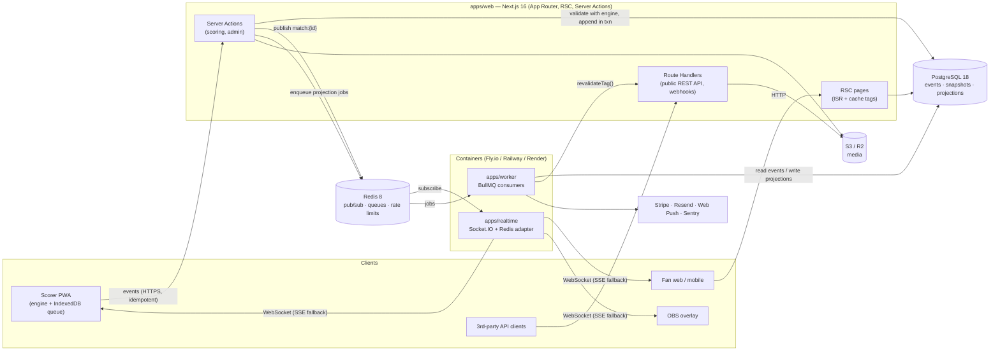
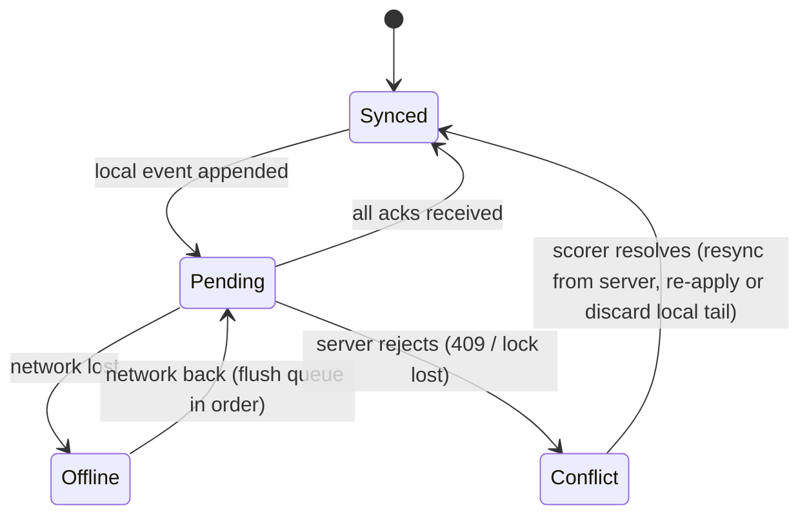
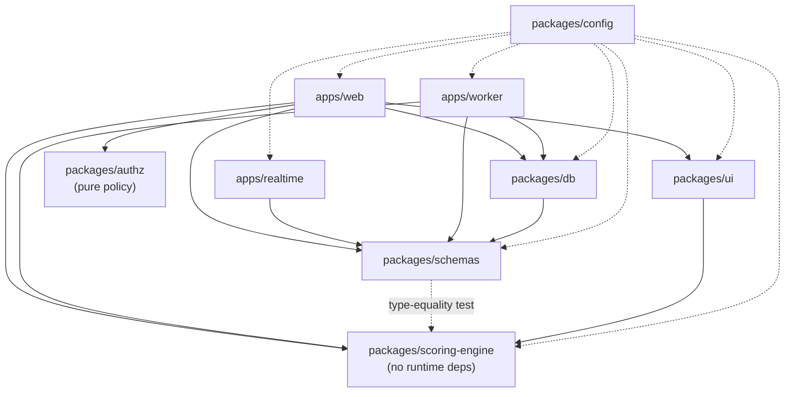

# Architecture

Status: **Phase 2** (auth, people, teams) complete. Diagrams show the target architecture; the "Where we are" table
shows what exists today.

## 1. System overview



## 2. Scoring write path (brief §4.5)

```mermaid
sequenceDiagram
  autonumber
  participant UI as Scorer UI
  participant L as Local engine + IndexedDB
  participant SA as Server Action submitEvent
  participant DB as Postgres
  participant R as Redis
  participant RT as Realtime
  participant Fan as Fan client

  UI->>L: tap "4"
  L->>L: applyEvent(state, e) → instant UI (< 50 ms)
  L->>L: persist e (status: pending)
  L->>SA: POST e {id, seq, ...} (sync queue, backoff)
  SA->>SA: can(user, "score", match) + scoring lock holder?
  SA->>DB: BEGIN; SELECT last snapshot + events FOR UPDATE of match row
  SA->>SA: engine.applyEvent → RuleViolation? reject 409
  SA->>DB: INSERT ball_events (ON CONFLICT (id) DO NOTHING); snapshot at END_OF_OVER; COMMIT
  SA->>R: PUBLISH match:{id} {seq, event}
  SA->>R: enqueue project-match job
  SA-->>L: ack {seq}
  R-->>RT: message
  RT-->>Fan: emit "event" {seq, event}
  Fan->>Fan: seq == last+1 ? apply : resync from lastSeq
```

**Idempotency.** The event `id` is a client-generated UUIDv7. A replayed POST hits the primary-key
conflict, and the server returns the already-stored `seq` if the payload is identical, or 409
otherwise.

**Ordering.** One active scorer per match (scoring lock with explicit handoff), so the server is
never merging concurrent streams. A client `seq` that doesn't equal `lastSeq + 1` is rejected and
the client resyncs.

## 3. Offline-first scoring (brief §4.6)



The scorer UI is a Client Component tree that owns a Zustand store wrapping the engine.
TanStack Query handles server state everywhere else.

## 4. Read path

- **Live match page:** RSC renders the scorecard from the latest snapshot plus tail events
  (cache-tagged `match:{id}`). The client hydrates, subscribes to the socket, and applies
  events with the same engine.
- **Stats pages:** RSC queries **projections** only (never raw events), cached with tags such
  as `player:{id}` and `tournament:{id}`, which the worker revalidates after a projection job.
- **Overlay** (`/overlay/[matchId]`): a client-only page with a transparent background and the
  socket feed.

## 5. Package boundaries



Rules (enforced by review now, by `eslint-plugin-boundaries` or dependency-cruiser from Phase 2):

- `scoring-engine` imports nothing outside itself. No Node built-ins, no DOM, no I/O.
- `schemas` may import engine **types** only.
- Only `db` talks to Postgres. Apps go through repositories in `db` and services in the app.
- In `apps/web`: `app/` (routes, thin) → `features/*/actions.ts` (thin server actions) →
  `features/*/service.ts` (business logic, `can()` checks) → `@cricket/db` repositories.

## 6. Authorisation model (brief §6)

`can(user, action, resource)` is a pure function over the user's `role_assignments`
(`role`, `scope_type`, `scope_id`) and the resource's ownership chain
(match → tournament → season → league → organisation). It's evaluated server-side in every
action and route handler. The UI uses the same function only to hide controls. Every admin
mutation writes `audit_log`.

## 7. Deployment

| Component     | Option A (recommended)                                  | Option B                         |
| ------------- | ------------------------------------------------------- | -------------------------------- |
| apps/web      | Vercel (Fluid Compute, Node runtime)                    | Container (`output: standalone`) |
| apps/realtime | Fly.io / Railway container, ≥2 instances, Redis adapter | same                             |
| apps/worker   | Fly.io / Railway container                              | same                             |
| Postgres      | Managed (Neon / Supabase / RDS) with PITR               | self-hosted + daily `pg_dump`    |
| Redis         | Managed (Upstash / Railway)                             | self-hosted                      |
| Storage       | Cloudflare R2                                           | any S3                           |

## 8. Where we are (end of Phase 2)

| Path                       | State                                                                                                              |
| -------------------------- | ------------------------------------------------------------------------------------------------------------------ |
| `apps/web`                 | Sign-in, accounts, leagues, clubs, teams, squads, players, claims, invitations, uploads; legacy scorer at `/local` |
| `apps/realtime`            | Skeleton: env validation + `/healthz`                                                                              |
| `apps/worker`              | Skeleton: env validation + `/healthz`                                                                              |
| `packages/scoring-engine`  | **Done**: reducer, replay, undo/corrections, all spec rules, metrics, CLI (100% covered)                           |
| `packages/schemas`         | Zod event/rules/result schemas, type-locked to the engine                                                          |
| `packages/db`              | Drizzle schema + migrations (Phase 2 tables), test-database helpers                                                |
| `packages/authz`           | Pure permission policy (`can`) and player privacy rules, 100% covered                                              |
| `packages/ui`              | Empty — Phase 3+                                                                                                   |
| `packages/config`          | Shared tsconfig bases + ESLint flat config                                                                         |
| `infra/`                   | docker-compose: Postgres 18, Redis 8.8, RustFS (S3), Mailpit                                                       |
| `.github/workflows/ci.yml` | format, lint, typecheck, test, engine coverage, build                                                              |
