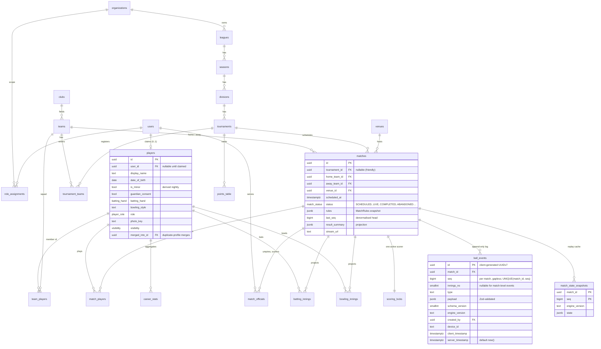

# Data Model

**Status:** Phase 2 tables are implemented (`packages/db/src/schema`, migrations in
`packages/db/migrations`). Later phases' tables below remain a draft. Decisions that are hard to
reverse are flagged **🔒**.

Conventions:

- PK `id uuid` = UUIDv7 (ADR-0011). FKs are `<table>_id`, every FK is indexed.
- `created_at`, `updated_at timestamptz` on every mutable table; soft delete (`deleted_at`) only
  where the brief needs recovery (users, players, teams).
- Tenant-owned tables carry `organization_id NOT NULL` (ADR-0014 🔒).
- Enums are Postgres enums for closed sets; free-form or extensible sets are `text` + check.
- JSONB only for (a) event payloads, (b) engine state snapshots, (c) `MatchRules` snapshot,
  and (d) tenant branding/config. Everything that's queried or filtered is a column.

## 1. ER diagram (core)

## 2. Tables by area and phase

### Identity & access — Phase 2

| Table                                            | Key columns                                                                                                                                                                                                                    | Notes                                                                       |
| ------------------------------------------------ | ------------------------------------------------------------------------------------------------------------------------------------------------------------------------------------------------------------------------------ | --------------------------------------------------------------------------- |
| `users`, `sessions`, `accounts`, `verifications` | Managed by Better Auth (ADR-0004)                                                                                                                                                                                              | `email citext unique`, `phone unique`                                       |
| `role_assignments`                               | `user_id`, `role` (SUPER_ADMIN, ORG_ADMIN, TOURNAMENT_ORGANIZER, CLUB_ADMIN, TEAM_MANAGER, CAPTAIN, SCORER, UMPIRE, REFEREE, PLAYER), `scope_type` (PLATFORM, ORGANIZATION, LEAGUE, TOURNAMENT, CLUB, TEAM, MATCH), `scope_id` | Unique `(user_id, role, scope_type, scope_id)`. "Fan" is implicit (no row). |
| `audit_log`                                      | `actor_id`, `action`, `resource_type`, `resource_id`, `organization_id?`, `before jsonb`, `after jsonb`, `ip`, `at`                                                                                                            | Append-only; partition by month later                                       |
| `consents`                                       | `user_id`, `kind` (MARKETING_EMAIL, GUARDIAN), `granted_at`, `revoked_at`, `granted_by`                                                                                                                                        | GDPR & minors                                                               |

### Organisations, clubs, teams, players — Phase 2

| Table              | Key columns                                                                                           |
| ------------------ | ----------------------------------------------------------------------------------------------------- |
| `organizations` 🔒 | `slug unique` (subdomain), `name`, `branding jsonb`, `stripe_account_id?`                             |
| `clubs`            | `name`, `slug`, `logo_key`, `home_venue_id?`                                                          |
| `teams`            | `club_id?`, `name`, `short_name`, `category` (SENIOR, WOMEN, JUNIOR, …), `logo_key`, `home_venue_id?` |
| `team_players`     | `team_id`, `player_id`, `joined_at`, `left_at?`, `squad_role` (CAPTAIN, VICE_CAPTAIN, WK, PLAYER)     |
| `players`          | see ER; `search_vector` + trigram index on `display_name`                                             |
| `player_merges`    | `from_player_id`, `into_player_id`, `approved_by`, `at`. Merges rewrite projections, never events.    |
| `invitations`      | `team_id`, `email/phone`, `player_id?`, `token_hash`, `expires_at`, `status`                          |
| `venues`           | `name`, `address`, `geo point?`, `organization_id?` (null = public venue)                             |
| `media_assets`     | `owner_type`, `owner_id`, `key`, `mime`, `bytes`, `status`                                            |

### Matches & scoring — Phase 3 (built; ADR-0017)

As built in migration 0003: `matches` has no `tournament_id` yet (Phase 6) and adds `preset`,
`summary` (the list projection: innings scores and a status line), `started_at`, `completed_at`
and a `CANCELLED` status. `match_players` adds `name` (the public-safe name written into events)
and `position` (batting order). `match_officials` holds umpires and the referee only; scorers are
`SCORER` role assignments on the `MATCH` scope. `match_state_snapshots` keeps one row per match
(PK `match_id`). `scoring_locks` and `commentary_overrides` come in Phases 4 and 5.

| Table                   | Key columns / constraints                                                                                                               |
| ----------------------- | --------------------------------------------------------------------------------------------------------------------------------------- |
| `matches`               | see ER. Index `(tournament_id, scheduled_at)`, `(status, scheduled_at)`.                                                                |
| `match_players`         | `match_id`, `team_id`, `player_id`, `is_substitute`, `is_captain`, `is_keeper`. PK `(match_id, player_id)`.                             |
| `match_officials`       | `match_id`, `user_id`, `role` (UMPIRE_1, UMPIRE_2, TV_UMPIRE, REFEREE, SCORER, SECOND_SCORER)                                           |
| `scoring_locks`         | `match_id PK`, `holder_user_id`, `holder_device_id`, `acquired_at`, `heartbeat_at`, `handoff_to_user_id?`                               |
| `ball_events` 🔒        | see ER. **No UPDATE/DELETE grants** for the app role (enforced by a trigger). Index `(match_id, seq)` unique; `(match_id, innings_no)`. |
| `match_state_snapshots` | Written at each `END_OF_OVER` and `INNINGS_ENDED`; `engine_version` mismatch ⇒ ignored.                                                 |
| `commentary_overrides`  | `match_id`, `event_id`, `text`, `edited_by` (Phase 5 feed uses auto text unless overridden)                                             |

### Projections (read models) — Phase 5

All rebuildable via `pnpm --filter @cricket/worker project:rebuild [--match <id>]`. Each row
carries `source_seq` (last event seq applied) for idempotent incremental updates.

| Table                                                                                                                             | Grain                                                                                          |
| --------------------------------------------------------------------------------------------------------------------------------- | ---------------------------------------------------------------------------------------------- |
| `batting_innings`                                                                                                                 | match × innings × player: runs, balls, 4s, 6s, dots, how_out, bowler_id, fielder_ids, position |
| `bowling_innings`                                                                                                                 | match × innings × player: legal_balls, maidens, runs, wickets, wides, no_balls, dots           |
| `fielding_records`                                                                                                                | match × player: catches, stumpings, run_outs (direct/assist), drops (if recorded)              |
| `partnerships`                                                                                                                    | match × innings × wicket_no                                                                    |
| `career_stats`                                                                                                                    | player × format × (all / season / tournament / team / opposition / venue) — see note           |
| `team_stats`, `head_to_head`, `points_table` (with NRR inputs: runs_for, balls_faced_for_nrr, runs_against, balls_bowled_for_nrr) |

Note: `career_stats` is a wide aggregate keyed by `(player_id, format, dimension, dimension_id)`.
The alternative (compute on read from `batting_innings`) may be fast enough at our scale. That
gets decided with `EXPLAIN` in Phase 5.

### Competitions — Phase 6

`leagues`, `seasons`, `divisions`, `tournaments` (`format`, `rules_preset`, `rules jsonb`,
`points_config jsonb`, `organization_id`), `tournament_stages` (group / knockout / playoff),
`tournament_teams` (`status`, `entry_fee`, `payment_id`), `fixtures` = `matches` with
`stage_id`, `round`, `leg`. `registrations` (players: eligibility, squad lock dates),
`official_availability`, `official_ratings`, `venue_bookings`, `disciplinary_records`,
`protests`, `result_approvals` (`match_id`, `submitted_by`, `approved_by`, `status`), `awards`.

### Commerce — Phase 6

`payments` (`stripe_payment_intent_id unique`, `status`, `amount`, `currency`, `organization_id`),
`stripe_events` (`id PK` = Stripe event id, for idempotency; `processed_at`).

### Engagement & platform — Phases 7–9

`follows` (`user_id`, `target_type`, `target_id`), `notifications`, `push_subscriptions`,
`posts`, `comments`, `reactions`, `reports`, `polls`, `poll_votes`, `api_keys` (`hash`,
`scopes`, `rate_limit`), `feature_flags`, `ai_usage` (tokens per tenant per day).

## 3. Open questions for the owner

1. **🔒 Tenancy (ADR-0014):** global players/teams with tenant-owned competitions. OK?
2. **🔒 Event table immutability:** a DB trigger blocking UPDATE/DELETE on `ball_events` (GDPR
   erasure would then pseudonymise `created_by` via a separate `users` deletion path, not touch
   events). OK?
3. **Minors:** the brief asks for restricted visibility. Proposal: `players.visibility` defaults
   to `PRIVATE_TO_TEAM` when `is_minor`. The public scorecard shows "J. Smith" (initial + surname)
   and no photo until guardian consent is recorded.
4. **Teams outside a club** (pick-up/box cricket teams): allowed (`club_id` nullable). OK?

## 4. Implementation notes (Phase 2)

- **Implemented:** `users`, `sessions`, `accounts`, `verifications`, `rate_limits` (Better Auth),
  `role_assignments`, `audit_log`, `consents`, `organizations`, `venues`, `clubs`, `teams`,
  `team_players`, `players`, `player_claims`, `invitations`, `join_requests`, `media_assets`.
- **`players.is_minor` is not stored.** Age is computed at read time (`@cricket/authz`
  `isMinor`) so it can never go stale; the planned nightly job is unnecessary.
- **Squad roles drive authz roles:** a claimed player in a squad holds `PLAYER` on that team, and
  the captain also `CAPTAIN` (kept in sync by `features/players/service.ts`). `TEAM_MANAGER` is
  granted separately.
- **Invitations** store `token_hash` (SHA-256), `squad_role`, optional `player_id` (an unclaimed
  profile to hand over), `accepted_by/at`; acceptance requires a matching email or phone.
- **Phone-only accounts** get a placeholder email `<digits>@phone.cricket.invalid`, never shown.
- **Media:** only processed WebP variants are stored (`media_assets.variants`), keyed under
  `media/<owner>/<id>/<uuid>/<size>.webp` (ADR-0015).
- **Deferred:** `player_merges` (Phase 5, with stats), keeper/admin management UI for
  `role_assignments` beyond creators and squads.
